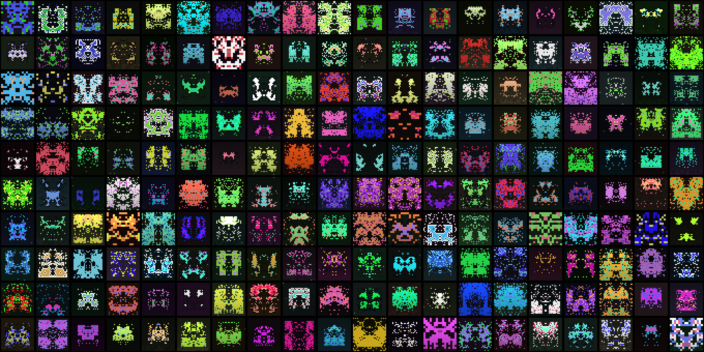

# описание

Генератор синтетических пиксельных абстракций в стиле 8-bit. Каждое изображение это симметричное «существо», полученное зеркалированием случайной маски, сглаженной клеточным автоматом. Затем добавляются акценты, контур, глаза, палитра в HSV и тёмный фон. Результат: uint8 массив (N, 32, 32, 3), воспроизводимый по seed
